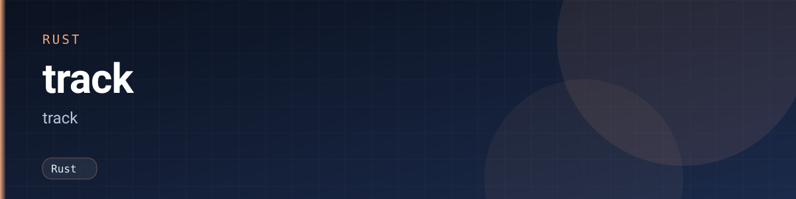

<div align="center">



# track — трекер времени / лайфлог

### Куда уходит время: активности в tagdb-записях (`.eml`), сводки по дням/неделям/ тегам через X-Query с header-only scan. Ноль зависимостей, один бинарь.

[](https://github.com/kostyk348/track/releases)
[](https://github.com/kostyk348/track/commits/master)

</div>

---


Построен на [emlbox](https://github.com/kostyk348/mime-os) (eml-tag).

## Установка

```bash
cargo build --release   # ./target/release/track
```

## Использование

```bash
track init ~/.track

# закрытый интервал

track log ~/.track --tag work --note "emlbox" --start 1700000000 --end 1700003600

# открытый интервал (удобно в терминале)

track now ~/.track --tag deep_work --note "mime-os sync"
... работаешь ...
track stop ~/.track        # -> stopped [deep_work] 42m 13s

# сводки

track day ~/.track                    # сегодня (UTC)
track day ~/.track 2026-08-12         # конкретный день
track week ~/.track
track tag ~/.track deep_work          # сколько всего на тег
track report ~/.track                 # всё время, по тегам
```

## Как это работает

Запись активности:

```
X-Record-ID: rec_<nanos> | current
X-Tag: deep_work
X-Timestamp: 1786554736
Content-Type: application/json

{"tag": "deep_work", "start": 1786554736, "end": null, "note": "mime-os sync"}
```

- Открытый интервал живёт в записи `current`; `stop` перезаписывает её атомарно
- Сводки: header-scan по `X-Timestamp` диапазону + чтение тела только у
  подходящих записей
- Время в UTC, даты по proleptic Gregorian (без внешних зависимостей)
- Corruption-proof: одна битая запись не рушит трекер

## Тесты

```bash
cargo test
```
